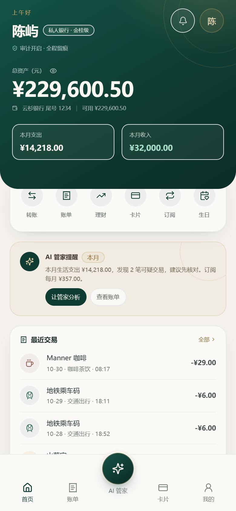

# AI 银行管家

> 会办事、可审计的银行 AI 智能体产品原型。
> 五档权限 · 收款人复述 · 一次性授权 · 多因子验证 · 人工审核 · 哈希链审计

[在线 Demo](https://ai-bank-butler-ysiju3b1a09.qoder.zone) · [测试与验证](TESTING.md) · [部署说明](docs/deploy.md) · [安全自评报告](docs/security-self-assessment.md) · [系统架构](docs/architecture.md)



## 作品简介（≤200 字）

我们构建了一个“说话就能办业务”的银行 AI 智能体：基于大模型意图解析与 Agent DAG 编排，自动拆解并安全执行转账、账单、理财、卡片、订阅与生日联动。产品支持手机号注册登录、独立数据空间与可安装 PWA；以五档权限为骨架，按风险自动执行、摘要确认、收款人复述、多因子验证或转人工，配合一次性操作授权、注入防御、数字一致性守卫、哈希链审计与受限沙箱，所有回执由工具结果渲染。

## 产品形态

- **手机 PWA**：登录 / 注册 / 一键体验，可添加到主屏幕，支持离线启动外壳。
- **多用户数据空间**：每个账号拥有独立的合成账户、6 个月流水、卡片、订阅、理财持仓、额度与安全状态；会话、确认、审核与审计按 `userId` 隔离。
- **AI 管家**：自然语言办理 6 个场景，复杂任务拆成 DAG；按五档权限执行确认、复述、人脸 / 短信或人工审核。
- **评委控制台 `/console`**：登录后从「我的 → 评委控制台」进入，查看意图、DAG、权限理由、审计链、攻击实验室、沙箱与 LLM 指标；与产品端共享账号数据，使用独立会话 key。
- **在线 Demo**：Qoder Site 直接运行产品端构建，打开即可登录或一键体验；`/api` 请求由同源 Edge Function 转发到产品服务，源码位于 [`site/`](site/)（构建产物）与 [`functions/`](functions/)。

作品名 **AI 银行管家**，拉丁字标 `AI BANK BUTLER`，集中在 `packages/shared/src/brand.ts` 维护。

## 五档权限

静态档位由工具与金额决定，风控智能体再按 14 类信号打分；最终档位取两者较高值，只升不降。

| 档位 | 名称 | 执行方式 | 典型操作 / 升档场景 |
| --- | --- | --- | --- |
| T0 | 自动执行 | 确认意图后直接执行 | 余额、流水、账单分析、产品与持仓查询 |
| T1 | 摘要确认 | 展示参数摘要，一次确认；90 秒一次性授权 | ≤ ¥1,000 转账、订阅取消、虚拟卡申请、小额调额 |
| T2 | 收款人复述 | 在摘要之上手输收款人姓名 | 新收款人、会话风险升高、行为基线偏离 |
| T3 | 多因子验证 | 人脸或本机生物识别；大额、挂失 / 解挂加短信 | > ¥1,000 转账、理财申赎、挂失 / 解挂、调额 > ¥2,000 |
| T4 | 人工审核 | 延迟 10 分钟到账，期内可撤销；拒绝或超时退回 | 单笔 > ¥5 万 |

拒绝边界：单笔超过 ¥200,000 或当日累计超过 ¥500,000。5 万元以上进入人工审核，不再一刀切禁止。

### 风控智能体 `risk-agent-v1`

`apps/server/src/policy/riskAgent.ts` 覆盖金额占比、30 天行为基线、收款人新异性、深夜时段、交易频次、拆分规避、会话风险、注入嫌疑、低置信度、风险名单、诈骗话术、收款人替换、新设备与额度余量 14 类信号。输出 0–100 分、命中项与建议档位，随 `POLICY_DECISION` 写入审计链；评分只读账本与会话事实，模型不参与打分。

### 关键安全机制

- **一次性授权**：`digest = sha256(userId|sessionId|runId|nodeId|tool|canonical(args))`；执行前重算，改单返回 `DIGEST_MISMATCH`，重放返回 `GRANT_ALREADY_USED`。
- **幻觉防护**：LLM 只输出意图与槽位；余额、流水、回执由工具结果模板渲染；数字守卫拦截证据外金额。
- **注入防御**：9 类输入特征 + 模型嫌疑信号 + 服务端工具白名单 / 策略 / 额度台账；连续命中触发 10 分钟熔断。
- **审计链**：append-only JSONL，逐条链接 `seq|prevHash|userId|type|ts|summary|payloadHash`；每 50 条 checkpoint；支持整链校验、副本篡改演练与按 run 回放。
- **额度与幂等**：`used = COMMITTED + HELD`，预留 120 秒过期；用户锁串行化；写操作绑定幂等键。
- **沙箱**：worker_threads + node:vm，无文件 / 网络 / 进程访问；800ms 软超时、2.2s 硬终止。
- **账号安全**：scrypt 密码哈希；HMAC 签名 HttpOnly Cookie（SameSite=Lax、HTTPS 下 Secure）；登录 / 注册 / 访客限流；可选注册短信验证与登录 MFA；支持会话列表与设备撤销。

## 六个场景

| 场景 | 可演示能力 |
| --- | --- |
| 智能转账 | 按人名 / 手机号 / 备注转账、同名联系人澄清、定时转账、AA 收款、当日冲正 |
| 账单分析 | 月 / 年账单、分类聚合、异常交易、重复扣费、上期对比、沙箱消费洞察 |
| 理财操作 | 风险测评读取、产品匹配对比、一键申购 / 赎回、持仓与收益展示 |
| 卡片管理 | 卡片与额度总览、虚拟卡申请、调额、冻结 / 解冻、挂失 |
| 订阅代扣 | 自动续费识别、涨价提醒、重复扣费检测、一键取消、可恢复 |
| 跨场景联动 | “我爱人生日”→ 锁定活期预算、预约鲜花 / 蛋糕、写入日程，一次对话完成 |

18 个业务模板登记在 `packages/shared/src/templates.ts`；规划器将其实例化为 DAG，并记录选择的模板与步骤。

## 真实接入能力

默认 `BANKING_MODE=simulated`，比赛现场零外部依赖。切换到 `http` 后，账户、流水、卡片、订阅、持仓与全部资金操作都经服务端银行核心网关：

- **统一契约**：`GET /v1/snapshot` 拉取快照；`POST /v1/ops` 执行转账、冲正、理财申赎、卡片、订阅、定时、资金锁定、礼物与 AA。
- **安全边界**：HMAC-SHA256 请求签名、5 分钟时间窗、nonce 防重放、`Idempotency-Key`、超时 / 重试 / 客户端熔断；失败显式报错，不回退合成数据。
- **快照校验**：上游报文经 Zod 严格校验后落盘；账户、卡、流水以银行返回为准。
- **真实核验**：`SMS_MODE=http` 调用签约短信服务；`FACE_MODE=http` 创建活体会话并轮询服务端结果，客户端无法伪造“已通过”。

```bash
# 银行核心 + 短信 + 人脸全部经 HTTP Provider（本地契约桩）
npm run smoke:full
```

接入步骤、签名算法、操作清单、错误码与 Provider 契约见 [银行核心接入说明](docs/banking-integration.md) 与 [OpenAPI 契约](docs/openapi-banking.yaml)。仓库不含真实银行密钥。

## 快速开始

环境：Node.js 24（≥ 20.19 亦可）、npm 11。Windows / macOS / Linux 可用，无 Docker、无原生依赖。

```bash
npm install
cp .env.example .env   # 可选：填入 OpenAI 兼容的 LLM Key
npm run dev
```

- 产品端：http://localhost:5173
- API 健康检查：http://localhost:8787/api/health
- 评委控制台：登录后访问 http://localhost:5173/console

没有 Key 也能跑：系统自动切换到规则引擎；也可以在「我的 → 离线兜底」或控制台顶部切换。

### 演示路径

1. 打开产品端 → 「一键体验」生成独立演示账户，或注册自己的账户。
2. 首页 → 「AI 管家」→ 说：`给林晚转 520 元，备注爱你` → 摘要确认 → 回执。
3. 继续说：`再给林晚转 6000 元` → 人脸 + 短信强验证；演示短信码由服务端下发并展示在页面。
4. 说：`这个月花了多少？有异常消费吗` → 账单、异常与沙箱洞察。
5. 说：`我爱人下周生日，帮我提前安排` → 一次确认批量执行。
6. 「我的 → 评委控制台」查看 DAG、策略理由、审计链，运行攻击实验室与安全自检。

### 环境变量

| 变量 | 默认 | 说明 |
| --- | --- | --- |
| `PORT` | `8787` | 服务端端口 |
| `DEMO_NOW` | `2026-10-30T10:00:00+08:00` | 演示时钟（只影响业务日期） |
| `BUSINESS_CLOCK` | 自动 | `demo` 用演示时钟；`real` 用真实时间 |
| `LLM_BASE_URL` | — | OpenAI 兼容地址，如 `https://api.deepseek.com/v1` |
| `LLM_API_KEY` | — | 仅服务端读取，不进入前端或仓库 |
| `LLM_MODEL` | `deepseek-chat` | 模型名 |
| `LLM_OFFLINE` | `0` | `1` = 启动即离线规则引擎 |
| `LLM_DAILY_LIMIT` | `500` | 全局日调用上限；超限自动规则兜底 |
| `COOKIE_SECURE` | `0` | 公网 HTTPS 部署设为 `1` |
| `AUTH_SECRET` | 自动生成 | 至少 32 字节；不设则写入 `DATA_DIR/runtime/auth-secret` |
| `DATA_DIR` | `./data` | 多用户状态、审计与密钥目录 |
| `BANKING_MODE` | `simulated` | `http` 时经签名网关读写银行核心 |
| `SMS_MODE` / `FACE_MODE` | `demo` | `http` 时接签约短信 / 活体核验服务 |
| `BANKING_*` / `SMS_*` / `FACE_*` | — | 地址与 HMAC 凭据，见[接入说明](docs/banking-integration.md) |

### 生产构建

```bash
npm run build
DATA_DIR="$PWD/data-public" PORT=8788 COOKIE_SECURE=1 npm start
```

构建产物在 `apps/web/dist`，API 同时托管前端。公网长期托管参考 [部署说明](docs/deploy.md)。

Qoder Site 的赛事 Demo：

```bash
npm run build:site   # 输出 site/，HashRouter + 同源 /functions/v1/app 代理
```

发布目录是 `site/`，同源 Edge Function 在 `functions/index.ts`，上游地址由 `APP_ORIGIN` 指定。详见 [部署说明](docs/deploy.md#3-qoder-site-在线-demo赛事链接)。

## 测试与验证

```bash
npm test              # 124 个 Vitest 用例 / 10 个测试文件
npm run smoke         # 独立临时服务 + 离线规则
npm run smoke:bank    # 六场景经 HTTP 银行核心适配层
npm run smoke:full    # 银行 + 短信 + 人脸均经 HTTP Provider
node tools/qa-product.mjs      # 生产构建 + headless Chrome 交互回归
node tools/qa-pure-product.mjs # 纯产品版页面检查
```

| 测试文件 | 覆盖内容 |
| --- | --- |
| `policy.test.ts` | 五档分层、当日累计、额度上限与拒绝边界 |
| `risk.test.ts` | 风控智能体评分、档位映射与静态档融合 |
| `safeguards.test.ts` | 收款人复述、人工审核入队与批准 / 拒绝 |
| `ledger.test.ts` | 预留-提交台账、并发与过期回收 |
| `audit.test.ts` | 哈希链完整性、篡改检测与 checkpoint |
| `nlu.test.ts` | 意图与槽位解析、注入话术拦截 |
| `planner.test.ts` | DAG 规划、依赖排序与模板选择 |
| `templates.test.ts` | 18 个模板注册与匹配优先级 |
| `integration.test.ts` | 银行 HTTP 签名、幂等、重试与快照校验 |
| `dispute.test.ts` | 交易争议工单、状态流转与 180 天窗口 |

最近一次开发期自查（2026-11-02）：

- 单元测试 10 个文件 / 124 个用例全部通过。
- 离线冒烟通过，审计链 264 条逐条校验通过。
- `smoke:bank` 与 `smoke:full` 通过；full 模式验证短信下发、人脸会话与服务端结果确认。
- 浏览器回归 33 项通过，覆盖注册、找回密码、风险测评、争议工单、语音输入、生物识别录入与控制台四档视口。

## 文档

- [测试与验证（用例、冒烟、浏览器回归、线上验收）](TESTING.md)
- [部署说明（本地、隧道、Qoder Site、Docker）](docs/deploy.md)
- [安全自评报告（威胁模型、五档矩阵、20 条已知风险）](docs/security-self-assessment.md)
- [系统架构与核心算法](docs/architecture.md)
- [API 与 SSE 契约](docs/api.md)
- [银行核心 / 短信 / 人脸接入说明](docs/banking-integration.md)
- [OpenAPI 银行接入契约](docs/openapi-banking.yaml)
- [5 分钟演示脚本 + 10 分钟答辩提纲](docs/demo-script.md)
- [功能实现核查报告](docs/feature-audit.md)
- [产品巡检报告](docs/product-review.md)
- [200 字作品简介](docs/submission-intro.md)
- [提交材料清单](docs/submission-checklist.md)

## 已知边界

- 默认使用合成数据、演示短信码与页面人脸动画；WebAuthn 本机生物识别与 HTTP Provider 是两条真实核验路径，正式接入仍需行方准入与模板报备。
- 多用户状态与额度台账为单机 JSON，仅支持单实例；生产需 Postgres / Redis、分布式锁与字段加密。
- 审计链可检测内容篡改，文件仍可被整体删除；无 WORM、KMS 签名与集中日志。
- T4 人工审核入队前跳过摘要与多因子，批准后未回写额度台账；生产需职责分离与双人复核。
- 在线 Demo 的页面由 Qoder Site 托管，API 经 Edge Function 代理到本机产品服务（Cloudflare Quick Tunnel）。电脑休眠、隧道重启或后端停机时，页面会提示“演示后端暂时不可达”；正式提交需把后端部署到固定公网地址并更新 `APP_ORIGIN`。站点已设为公开，评委无需登录即可打开；需要收回时可在 Qoder Site 设置中改回私有。
- 未做渗透测试与第三方安全评估；完整 20 条风险与生产化建议见 [安全自评报告](docs/security-self-assessment.md)。

## 目录

```
apps/server        Fastify API、账号认证、Agent 运行时、五档策略 / 风控 / 审计 / 沙箱
apps/web           产品端 PWA、评委控制台、设计系统
packages/shared    类型、风险常量、18 个业务模板、品牌、SSE 契约
site               产品端生产构建（Qoder Site 发布目录）
functions          Edge Function：同源 /api 反向代理（固定上游 APP_ORIGIN）
scripts            smoke / e2e / 重置 / PWA 图标生成
docs               架构、API、安全自评、接入、演示、部署、截图
data               本地开发运行时状态与审计（gitignored）
```

> 全部账户、流水、联系人与持仓为合成数据，不构成真实金融服务、投资建议或合规结论。
