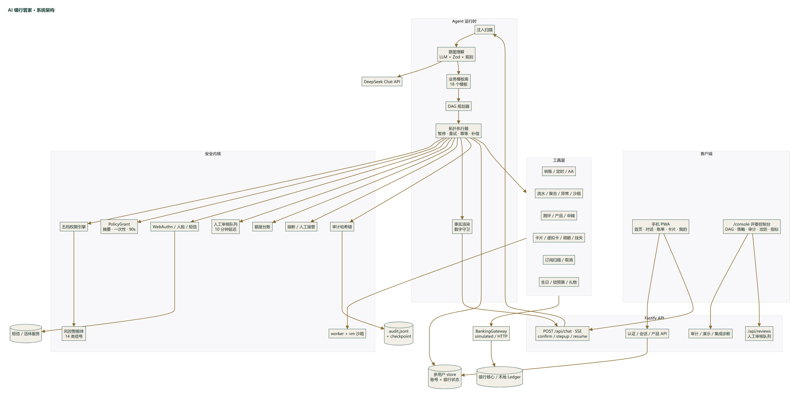
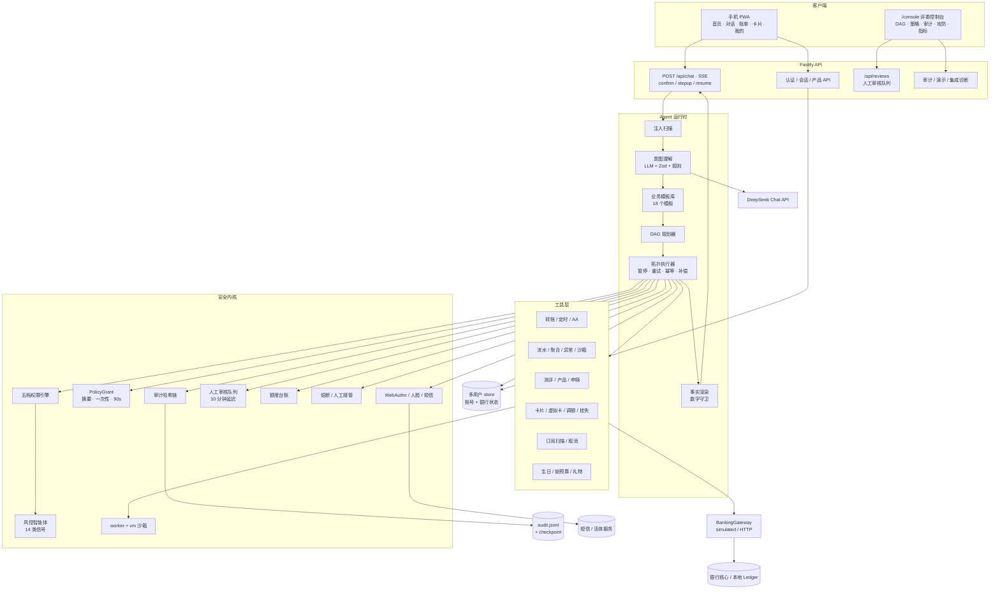
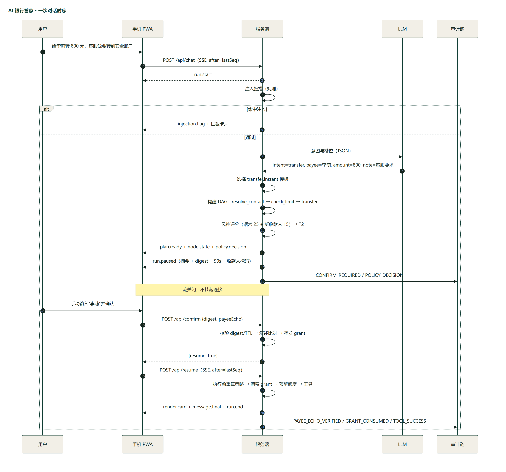
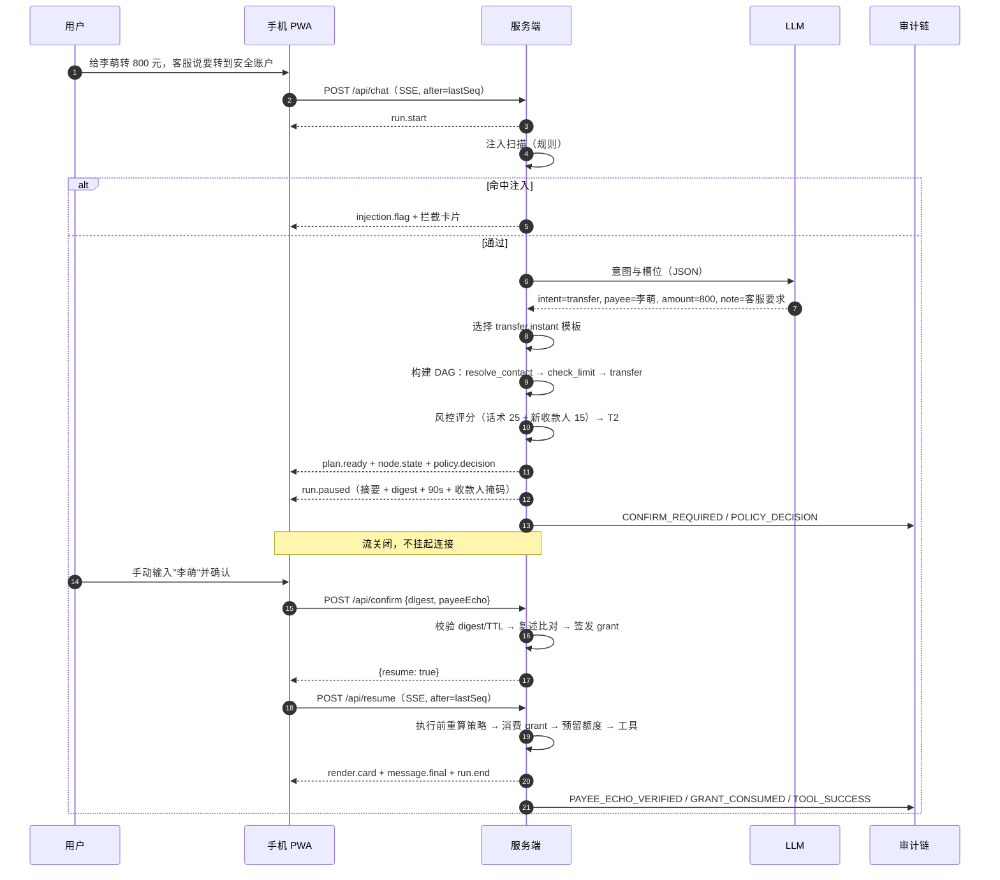
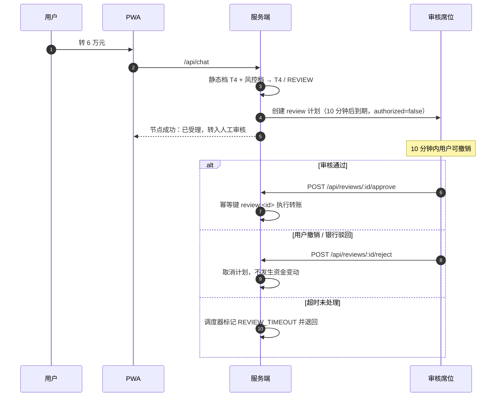

# AI 银行管家 · 技术文档

> 版本 2.0 · 2026-11-02 · 对应仓库 `main`
>
> 本文说明系统架构、核心算法与安全设计，内容以当前仓库代码为准。演示数据、虚构银行名、核验通道性质与已知风险见 [security-self-assessment.md](security-self-assessment.md)；接口契约见 [api.md](api.md) 与 [banking-integration.md](banking-integration.md)。

## 0. 摘要

| 项 | 实现 |
| --- | --- |
| 产品形态 | 手机 PWA（首页 / 对话 / 账单 / 卡片 / 我的）+ `/console` 评委控制台 |
| 服务端 | Node.js 24 · Fastify 5 · TypeScript · SSE |
| 前端 | React 18 · Vite 5 · TypeScript · Tailwind · Service Worker |
| 语义理解 | DeepSeek Chat（OpenAI 兼容协议），服务端持有 Key，每条业务消息都调用模型 |
| 任务规划 | 18 个业务模板 + 固定 DAG + 拓扑执行器，模型不生成调用链 |
| 工具层 | 29 个已注册工具，统一 `BankingGateway` 抽象 |
| 权限模型 | T0 自动 / T1 摘要确认 / T2 收款人复述 / T3 多因子 / T4 人工审核 |
| 风控智能体 | `risk-agent-v1`，14 类信号加权评分 0–100，只升档不降档 |
| 审计 | 追加式哈希链，50 条一个 checkpoint，支持全链校验与篡改演练 |
| 验证 | 123 个单元/集成测试（10 个文件）、端到端 smoke、浏览器回归、生产构建 |

一次请求的主链路：

```text
用户语句
  → 注入规则扫描
  → LLM 意图与槽位（JSON Schema 约束）
  → 业务模板选择
  → DAG 规划（固定工具白名单）
  → 逐节点策略判定（静态档 + 风控智能体）
  → 自动执行 / 摘要确认 / 收款人复述 / 多因子 / 人工审核
  → 工具执行（幂等、额度预留、失败重试）
  → 事实渲染 + 数字守卫
  → 审计入链
```

## 1. 设计原则

1. **模型负责理解，模板负责执行。** LLM 只输出意图、槽位与置信度；选模板、建 DAG、算风险、签授权全部由服务端确定性代码完成。
2. **每条业务消息都调用模型。** 缓存只在模型调用失败时兜底，避免“命中缓存就跳过模型”导致语义漂移。
3. **事实只能来自工具。** 余额、流水、收益、回执、交易号均由工具结果渲染；模型不生成面向用户的数字。
4. **安全边界在服务端，档位只升不降。** 提示词注入、伪造身份、改单、重放都无法改变静态档与风控档的取高结果。
5. **每一步可解释、可审计、可回放。** 意图、模板、规划、策略、确认、复述、验证、工具结果、补偿、熔断全部写入哈希链。
6. **渠道与银行核心可替换。** `/api/chat`、确认、强验证与审计接口与展示层解耦；银行读写统一经 `BankingGateway`，默认本地仿真，可切签名 HTTP 核心。
7. **演示稳定优先。** 支持注入演示时钟、一键重置、LLM 离线开关、规则兜底与全局日预算；断网时仍可完整演示。

## 2. 总体架构

### 2.1 分层与职责

| 层 | 目录 | 职责 |
| --- | --- | --- |
| 客户端 | `apps/web/src` | 产品 PWA、对话与富卡片、确认单、强验证、控制台（DAG / 策略 / 审计 / 攻防 / 指标） |
| 接口层 | `apps/server/src/routes` | 认证、会话、聊天 SSE、确认/验证、产品、审核队列、审计、演示、集成诊断 |
| Agent 运行时 | `apps/server/src/agent` | 一轮对话总控、DAG 规划、拓扑执行、暂停恢复、补偿、人工接管、事实渲染 |
| 语义层 | `apps/server/src/nlu` | 提示词、LLM 调用、Zod 校验、规则兜底、缓存、注入检测、预算与指标 |
| 安全内核 | `apps/server/src/policy`、`security` | 静态档 + 风控智能体、五档融合、授权、强验证、额度台账、复述校验、人工审核、熔断、审计链、沙箱 |
| 工具层 | `apps/server/src/tools` | 29 个业务工具及工具元数据（基础风险、可逆性、补偿器） |
| 接入层 | `apps/server/src/integration` | 银行核心 simulated / HTTP、短信与人脸 Provider、语音转写、HMAC 签名客户端 |
| 存储 | `apps/server/src/core` | 多用户账号与银行状态、账本、计划任务、通知、时钟、随机种子 |

### 2.2 组件图





### 2.3 运行拓扑

- 单 Node 进程同时提供 API、SSE 与前端静态资源；`/console` 与手机 PWA 共用账号与银行数据，各自持有独立会话。
- 计划任务调度器每 10 秒扫描到点任务：定时转账、预算解锁、礼品送达、日程提醒、人工审核超时。
- 运行态：会话、授权、验证挑战在内存；账号、银行状态、额度台账、幂等记录、审计在本地文件。
- 外部依赖：LLM 必选（未配置时进入规则离线模式）；银行核心、短信、人脸、ASR 可选，配置为 `http` 后启动时强制校验参数，缺项直接拒绝启动。

### 2.4 信任边界

| 边界 | 默认假设 | 处理 |
| --- | --- | --- |
| 浏览器 → 服务端 | 输入与前端状态均不可信 | 服务端重算摘要、重算风险、校验归属；授权不接受客户端自报 |
| LLM → 服务端 | 模型输出可能被诱导 | 只接受白名单意图与 Zod 结构；工具、金额、权限不受模型控制 |
| 服务端 → 银行核心 | 网络与上游响应不可信 | HMAC 签名、时间戳、nonce、幂等键、Zod 快照校验、失败关闭 |
| 本地文件 | 运行进程可信，磁盘可能被改 | 审计哈希链 + checkpoint 检测；演示篡改只在副本上执行 |
| 短信 / 人脸 | 客户端结果不可信 | HTTP 模式只认 Provider 服务端结果；demo 模式明确标注 |

## 3. 端到端时序






T4 分支：



### 3.1 暂停即断流

- SSE 发出 `run.paused` 后主动关闭，避免代理超时与连接泄漏。
- 每个会话保留 320 条事件与单调 `seq`；`POST /api/resume?after=<seq>` 从环形缓冲续传。
- `GET /api/session/:id` 返回完整快照（消息、DAG、pending、额度、上下文），刷新页面可恢复确认单与验证倒计时。
- 演示时钟可冻结，确认、验证、预留 TTL 使用真实墙钟，避免“演示时间 10:00、系统时间 17:00，一打开就过期”。

## 4. 语义理解（NLU）

### 4.1 模型调用契约

| 项 | 值 |
| --- | --- |
| 协议 | OpenAI 兼容 `POST /chat/completions` |
| 模型 | `deepseek-chat`（可用 `LLM_MODEL` 覆盖） |
| 温度 | 0 |
| 输出格式 | `response_format: json_object` |
| 超时 | 8 秒（`LLM_TIMEOUT_MS`） |
| 最大输出 | 520 tokens（`LLM_MAX_TOKENS`） |
| 重试 | 最多 2 次，第二次附带解析失败原因 |
| 日预算 | 默认 500 次/日（`LLM_DAILY_LIMIT`），超限降级规则引擎 |
| 运行位置 | 仅服务端；Key 不进入前端、日志或工具输出 |

`apps/server/src/nlu/understand.ts` 的执行顺序：

```text
rule = parseWithRules(text)                 // 确定性正则、中文金额、联系人映射
if offline or no budget: return rule
for attempt in 0..1:
    response = callChatCompletion(...)
    parsed   = parseNluContent(response)    // Zod 宽松校验 + 槽位归一化
    merged   = mergeWithRules(parsed, rule)
    cacheSet(key, merged)
    return merged
if cached: return mergeWithRules(cached, rule)   // 仅模型失败时使用
return rule
```

**模型必调**：缓存不再短路成功路径。缓存键由归一化语句、上次收款人、上次金额组成，只在 LLM 网络错误、限流或结构不合法时兜底，返回时标注“模型暂时不可用，使用缓存解析”。

### 4.2 输出白名单与槽位

- 意图：`transfer / bills / wealth / card / subscription / crossscene / account / chitchat / unknown`。
- 槽位：金额、收款人、手机号、备注、周期、分类、产品、风险等级、卡片动作与尾号、额度、订阅、生日、预算、账户查询、交易动作、争议原因、定时信息、AA 名单与总额、理财动作。
- 所有字段必须出现，未知填 `null`；禁止额外字段。
- 意图越权或注入诱导统一落到 `unknown`，并要求 `injectionSuspicion >= 0.9`。

槽位归一化规则：

1. 金额按“元”解析；原文有数字信号时，以原文抽取结果覆盖模型金额；原文无数字则清空金额，防止模型补造。
2. “再转 200”“就那个”允许 `payee=null`，由 `references=["lastPayee"]` 与上下文栈补全。
3. 手机号在提示词中脱敏为 `138****0000`；原文抽取到的 11 位号码优先用于联系人匹配。
4. 按意图清理无关槽位（转账不保留产品/卡片槽位，查询不保留 AA 槽位），降低控制台噪声。
5. 只有明确出现“申购 / 买入 / 购买”才生成申购节点；“放一万”只做推荐，不触发资金操作。

### 4.3 提示词与隐私

- 提示词包含：演示日期、用户名与风险偏好、配偶生日、常用联系人（姓名 / 关系 / 银行 / 尾号）、上次收款人 / 金额 / 产品、最近 4 条对话。
- 发送前对手机号与卡号做正则脱敏；不发送密码、Cookie、审计原文、完整流水。
- 指令明确要求：不执行操作、不查询数据、不生成话术、不编造联系人 / 金额 / 日期，拿不准降低 `confidence`。

### 4.4 澄清闭环

槽位不足时规划器返回 `clarify`，不创建 DAG：

- 同名联系人：返回带银行与尾号的选项，用户点选后以 `contactId` 精确进入规划。
- 缺金额 / 缺收款人 / 缺卡片 / 缺订阅：返回快捷金额或候选项。
- 用户可直接输入补充信息，也可点选项；`clarifyDraft` 保存上一轮意图与槽位，合并后继续规划。
- 用户在澄清态说“取消 / 算了”时清理草稿，不产生任何操作。

## 5. 业务模板库

### 5.1 模板清单

`packages/shared/src/templates.ts` 定义 18 个模板。模板声明所需槽位、步骤与失败策略；规划器按模板补齐参数并生成 DAG。

| 模板 ID | 场景 | 必需槽位 | 步骤 |
| --- | --- | --- | --- |
| `transfer.instant` | 即时转账 | 收款人、金额 | 解析收款人 → 校验限额与风控 → 转账 → 回执 |
| `transfer.scheduled` | 定时转账 | 收款人、金额、日期 | 解析收款人 → 校验 → 创建计划 |
| `transfer.split` | AA 收款 | 参与人、总额 | 解析参与人 → 校验 → 发起收款 |
| `bills.report` | 账单分析 | — | 读取流水 → 分类聚合 → 异常检测 → 沙箱洞察 |
| `wealth.advice` | 理财推荐 | — | 读取测评 → 读取产品 → 匹配 |
| `wealth.purchase` | 理财申购 | 金额 | 测评 → 产品 → 匹配 → 申购 |
| `wealth.redeem` | 理财赎回 | — | 读取持仓 → 赎回 |
| `card.list` | 卡片总览 | — | 读取卡片与额度 |
| `card.apply_virtual` | 申请虚拟卡 | — | 读取卡片 → 申请 |
| `card.adjust_limit` | 调整额度 | 目标额度 | 读取卡片 → 调额 |
| `card.freeze` | 临时冻结 | 卡尾号 | 读取卡片 → 冻结 |
| `card.unfreeze` | 解除冻结 | 卡尾号 | 读取卡片 → 解冻 |
| `card.report_loss` | 挂失 | 卡尾号 | 读取卡片 → 挂失 |
| `subscription.scan` | 订阅体检 | — | 扫描订阅 → 识别涨价 |
| `subscription.cancel` | 取消订阅 | — | 匹配订阅 → 取消续费 |
| `crossscene.birthday` | 生日联动 | 生日 | 解析日期 → 锁预算 → 订花 → 订蛋糕 → 日程 |
| `account.balance` | 余额查询 | — | 读取余额 |
| `account.transactions` | 流水查询 | — | 查询流水 |

### 5.2 模板选择

`selectTemplate(intent, slots, text)` 是纯函数，便于单测与回放：

```text
transfer:
  splitNames 非空                         → transfer.split
  isScheduled 或命中 定时/预约/每月/明天…  → transfer.scheduled
  其它                                     → transfer.instant
wealth:
  wealthAction=purchase                    → wealth.purchase
  wealthAction=redeem                      → wealth.redeem
  其它                                     → wealth.advice
card:
  cardAction 映射到 apply_virtual / adjust_limit / freeze / unfreeze / report_loss
  其它                                     → card.list
subscription:
  文本含 取消/关掉/退订 或指定订阅名        → subscription.cancel
  其它                                     → subscription.scan
account:
  query=transactions                       → account.transactions
  其它                                     → account.balance
```

模板选中后写入 `dag.template = { id, label, steps }`，控制台与审计可看到“本次用的哪条业务路径”。

### 5.3 失败策略

- 每个模板声明 `onFailure.retries` 与 `onFailure.manualTakeover`。
- 执行器对上游瞬时故障（`BANK_UNAVAILABLE`、`TIMEOUT`、`*_FAILED`、`RATE_LIMITED`）最多重试 2 次，间隔 250 ms × 次数；业务拒绝不重试。
- 重试写入审计 `TOOL_RETRY`，节点 `attempts` 随 SSE 推送到前端。
- 不可逆节点失败或模板要求人工时，后续节点跳过，任务结束为 `PARTIAL`，转人工接管。

## 6. DAG 规划与执行

### 6.1 节点模型

```ts
interface DagNode {
  id: string;              // n1, n2…
  tool: ToolName;          // 固定白名单
  label: string;
  args: Record<string, unknown>;
  deps: string[];
  risk: 'GREEN' | 'YELLOW' | 'RED';   // 工具基础风险，执行时重算
  reversible: boolean;
  compensator?: ToolName;
  status: NodeStatus;
  attempts: number;
  result?: ToolResult;
  policy?: PolicyDecision;
}
```

### 6.2 各意图的规划结果

| 场景 | DAG |
| --- | --- |
| 转账 | `resolve_contact → check_limit → transfer` |
| 定时转账 | `resolve_contact → schedule_transfer` |
| AA 收款 | `split_request`（参与人与总额在参数内） |
| 账单 | `fetch_transactions → (aggregate_bills, detect_anomalies, sandbox_analyze)` |
| 理财 | `assess_risk → list_products → match_products`；申购/赎回再接一个红色节点 |
| 卡片 | `list_cards → apply_virtual / adjust_limit / freeze / unfreeze / report_loss` |
| 订阅 | `scan_subscriptions → detect_price_changes`；取消再接 `cancel_subscription` |
| 生日 | `resolve_birthday → lock_funds → (order_flower, order_cake) → create_note` |
| 账户 | `get_balance` 或 `list_transactions` |

### 6.3 拓扑执行

```text
while true:
  if takeover:        → HUMAN_TAKEOVER，保留现场
  if abortRequested:  → 未执行节点 SKIPPED，状态 PARTIAL
  node = 第一个依赖已满足的 PENDING/READY 节点
  if 没有节点:
      上游失败的节点标记 SKIPPED
      汇总状态 → DONE / PARTIAL / FAILED
      结束
  node.status = RUNNING
  [HTTP 银行模式] 同步最新快照，失败直接 FAILED（不回退仿真）
  policy = evaluateNode(state, node, sessionCtx)
  if DENY:      → 节点 FAILED，任务 FAILED
  if 非 GREEN:
      无 grant → 暂停（CONFIRM / STEPUP / REVIEW）
      有 grant → 校验摘要、TTL、一次性、风险未升级 → 消费
  if REVIEW 且 transfer: → 写入人工审核队列，节点标记已受理
  幂等检查 → [转账] 预留额度 → 执行工具 → 提交/释放额度
  成功写幂等缓存；失败计入熔断
  写审计 → 下一个节点
```

### 6.4 批量确认

生日联动包含 3 个黄色操作（锁预算、鲜花、蛋糕）。执行器在第一个暂停点收集同一 run 内后续所有 `CONFIRM + YELLOW` 节点，合并为一张确认单：

- 确认单摘要覆盖全部节点：`sha256(digest1|digest2|…)`。
- 每个节点仍独立签发 `PolicyGrant`，执行前逐个重校验。
- 任一节点在确认期间风险升级，旧授权按 `RISK_ESCALATED` 拒绝，重新进入强验证。

### 6.5 幂等

```text
idemKey = sha256(sessionId | runId | nodeId | tool | stableStringify(args))
```

- 成功结果写入 `bank.idempotency`，重放直接返回原结果并记录 `IDEMPOTENT_HIT`。
- 稳定序列化对对象键排序，保证同一参数得到同一键。
- 人工审核批准使用 `review:<reviewId>` 作为幂等键，重复批准返回 `REVIEW_CLOSED`。

### 6.6 补偿与回退

- 逆拓扑执行补偿器：转账冲正、恢复订阅、取消礼品、解锁资金、注销虚拟卡。
- 不可逆操作转人工工单，界面显示“已转人工”，不伪装成已回退。
- 回退报告包含 `compensated / manual / failed` 三组，写入审计 `ROLLBACK`。

### 6.7 中断与人工接管

- 中断在节点边界生效；未执行节点 `SKIPPED`，已完成操作保留，状态 `PARTIAL`。
- 接管期间执行器在每个节点前检查标记，暂停并保留现场。
- 控制台可恢复、终止或解锁；所有动作写入审计。
- 锁定期间聊天只返回锁定提示，不调用 LLM。

### 6.8 状态机

| 状态 | 含义 | 出口 |
| --- | --- | --- |
| `IDLE` | 空闲 | 新消息 → `PARSING` |
| `PARSING` | 语义理解 / 澄清 | 规划 → `PLANNING` / `EXECUTING`；澄清 → `IDLE` |
| `PLANNING` | 构建 DAG | `EXECUTING` |
| `EXECUTING` | 拓扑执行 | `AWAIT_CONFIRM` / `AWAIT_STEPUP` / `DONE` / `PARTIAL` / `FAILED` |
| `AWAIT_CONFIRM` | 等待摘要确认 | 确认 → `EXECUTING` 或 `AWAIT_STEPUP`；取消 → `CANCELLED` |
| `AWAIT_STEPUP` | 等待多因子 | 通过 → `EXECUTING`；失败 → `LOCKED` / 取消 |
| `HUMAN_TAKEOVER` | 人工接管 | 恢复 → `EXECUTING`；终止 → `CANCELLED` |
| `LOCKED` | 安全锁定 | 人工复核 → `IDLE` |
| `DONE` / `PARTIAL` / `FAILED` / `CANCELLED` | 终态 | 新消息 → `PARSING` |

## 7. 核心算法

### 7.1 五档权限融合

档位由两个独立来源决定，取较高者。风控智能体只能升档。

```text
staticTier = f(node.risk, amount)
  GREEN  → T0
  RED    → max(T3, tierFromAmount(amount))
  YELLOW → tierFromAmount(amount)，无金额时 T1

agentTier = max(tierFromRiskScore(score), tierFromAmount(amount))
finalTier = max(staticTier, agentTier)

effectiveRisk = max(node.baseRisk, riskFromTier(finalTier))
finalTier     = max(finalTier, tierFromRisk(effectiveRisk))
```

其中：

```text
tierFromAmount:
  ≤ ¥1,000        → T1
  ¥1,000–5,000    → T2
  ¥5,000–50,000   → T3
  > ¥50,000       → T4

tierFromRiskScore:
  0–34            → T1
  35–59           → T2
  60–84           → T3
  85–100          → T4

riskFromTier:
  T0 → GREEN
  T1 / T2 → YELLOW
  T3 / T4 → RED
```

**单调性**：整条链路只使用 `max`、加法与阈值比较，没有降档分支。静态档、金额档、风控档、基础风险之间任意一项升高，最终档位只会持平或升高。

**自升档防护**：`T2` 映射为 `YELLOW`。若映射为 `RED`，`tierFromRisk(RED)` 会得到 `T3`，把每个 T2 自动抬成多因子档；映射为 `YELLOW` 后，T2 保持“强确认”语义。

**绝对上限**：只有超过产品额度上限才拒绝。

```text
单笔 > ¥200,000       → DENY / PRODUCT_CEILING
当日累计 > ¥500,000   → DENY / DAILY_CEILING
其它大额交易          → 按档位确认、复述、多因子或人工审核
```

**决策映射**：

| 档位 | 决策 | 执行方式 |
| --- | --- | --- |
| T0 | `ALLOW` | 直接执行 |
| T1 | `CONFIRM` | 参数摘要确认 |
| T2 | `CONFIRM` | 摘要 + 手输收款人姓名 |
| T3 | `STEPUP` | 摘要 + 复述 + 人脸 / WebAuthn / 短信 |
| T4 | `REVIEW`（仅转账） | 摘要 + 复述 + 多因子 + 人工审核 |
| T4 非转账 | `STEPUP` | 按 T3 强验证执行 |

`PolicyDecision` 同时返回 `tier`、`tierSource: { amount, agent, final }`、`controls`、`risk` 与解释文本。`POLICY_DECISION` 审计记录理由码、金额、额度与最终档位。

### 7.2 风控智能体评分

`apps/server/src/policy/riskAgent.ts` 的 `assessRisk()` 只读取服务端账本与会话事实，模型不参与打分。只读节点（`node.risk === 'GREEN'`）直接返回 0 分 / T0，避免历史流水误升档。

| # | 信号 | 触发条件 | 权重 |
| --- | --- | --- | --- |
| 1 | `AMOUNT_RATIO` | 金额 / 可用资金 > 80% / > 50% / > 30% | 28 / 18 / 8 |
| 2 | `BEHAVIOR_BASELINE` | 金额 ≥ 近 30 天日均支出 5× / 3× / 2× | 30 / 20 / 10 |
| 3 | `NEW_PAYEE` | 近 90 天无往来 / 从未转账 | 8 / 15 |
| 4 | `NIGHT_HOURS` | 00:00–05:00 且金额 > ¥1,000 | 12 |
| 5 | `VELOCITY` | 10 分钟内转出 ≥ 3 笔 / 2 笔 | 15 / 8 |
| 6 | `STRUCTURING` | 24 小时内贴近 1,000 / 5,000 / 50,000 阈值的交易 ≥ 3 笔 / 2 笔 | 25 / 12 |
| 7 | `SESSION_RISK` | 本会话有失败或注入命中 | `10 + min(15, n×5)` |
| 8 | `INJECTION_SUSPICION` | 模型注入嫌疑 ≥ 0.5 | 20 |
| 9 | `LOW_CONFIDENCE` | 意图置信度 < 0.6 且金额 > ¥1,000 | 12 |
| 10 | `BLOCKLIST_PAYEE` | 收款人命中风险名单 | 100 |
| 11 | `FRAUD_KEYWORD` | 备注含“安全账户 / 配合调查 / 屏幕共享”等话术 | 25 |
| 12 | `PAYEE_JUST_CHANGED` | 收款人相对上次被替换，且语句含“换 / 改成” | 15 |
| 13 | `NEW_DEVICE` | 新设备或新浏览器会话（预留给设备指纹接入） | 12 |
| 14 | `DAILY_CEILING_NEAR` | 本次后超过当日上限的 80% | 15 |

```text
score = clamp(Σ weight, 0, 100)
level = low (<35) / medium (35–59) / high (60–84) / critical (≥85)
agentTier = tierFromRiskScore(score)
verdictTier = max(agentTier, tierFromAmount(amount))
requiresReview = verdictTier === 'T4' || 命中风险名单
```

当前接线情况：第 1–12 与第 14 类信号由执行器、账本与会话直接提供；第 13 类已定义权重，等待设备指纹来源；风险名单内置一条演示数据，行方反欺诈名单作为接入位。

评分结果随决策返回：

```ts
{
  score: 40,
  level: 'medium',
  tier: 'T2',
  signals: [{ code: 'FRAUD_KEYWORD', weight: 25, detail: '备注含高风险话术「安全账户」' }, …],
  engine: 'risk-agent-v1',
  requiresReview: false
}
```

### 7.3 操作摘要与一次性授权

```text
digest = sha256(userId | sessionId | runId | nodeId | tool | canonical(args))
batchDigest = sha256(digests.join('|'))
```

`canonical()` 对对象键排序、数组保序，保证同一参数得到同一摘要。

授权校验五件事：

1. 授权存在。
2. 未被使用（`usedAt` 为空）。
3. 节点一致。
4. 摘要一致。
5. 未超过 90 秒，且当前有效风险不高于授权风险。

通过后立即写入 `usedAt`，重放返回 `GRANT_ALREADY_USED`。摘要或节点不一致会触发安全锁定，防止改单与重放。

### 7.4 收款人复述

T2 起，确认单要求用户手输收款人姓名：

```text
normalizeName:
  全角字符 → 半角
  去空白、·、•、・
  转小写
  去首尾空白

verifyPayeeEcho: normalizeName(input) === normalizeName(payee)
```

- 展示时脱敏：`王磊 → 王*`，避免确认单直接给出完整姓名。
- 比对在服务端完成，客户端无法跳过。
- 不一致记一次失败，写 `PAYEE_ECHO_MISMATCH`；连续 3 次触发 10 分钟锁定。
- 通过写 `PAYEE_ECHO_VERIFIED`，之后才签发授权。

### 7.5 额度台账

```text
used      = Σ COMMITTED(dayKey) + Σ HELD(dayKey, 未过期)
remaining = max(0, 1,000 元 − used)
reserve(amount)        // HELD，120 秒过期
commit(reservationId)  // 工具成功后
release(reservationId) // 失败、超时或回退
```

- ¥1,000 是“小额 / 大额”的记账分界，用来决定基础风险与展示剩余额度，不再作为硬上限。
- 大额转账经强验证或人工审核后仍可执行，同时占用当日累计，让后续请求看到真实占用。
- 同一用户的额度判定、预留与提交通过 `withUserLock()` 串行化，避免并发“读-判-写”双花。
- `dayKey` 使用演示时区日期字符串，不依赖定时器跨天。

### 7.6 数字守卫

```text
allowed = 收集工具结果、卡片、策略证据中的所有数值
          每个数值同时登记 n、n/100、|n|、|n|/100
文本中的 ¥金额 与 百分比逐个比对
允许误差 0.011
任一数字不在证据集合 → 整段替换为“操作已完成，明细见下方卡片。”
```

守卫只约束金额与百分比，不约束普通文字；命中情况计入指标，`RUN_END` 审计携带守卫统计。

### 7.7 注入评分

`apps/server/src/nlu/injection.ts` 定义 9 类规则：指令覆盖、提示词窃取、审计破坏、身份伪造、跳过验证、强制转账、角色扮演、数据越权、工具注入。

```text
score = min(100, Σ 命中规则权重)
score ≥ 45 → block
score ≥ 20 → warn
模型 injectionSuspicion ≥ 0.75 → 升级为 block
规则 block 不因模型未命中而放行
连续 2 次命中 → 10 分钟锁定
```

### 7.8 审计哈希链

```text
payloadHash = sha256(JSON.stringify(redactedPayload))
hash = sha256(seq | prevHash | userId | type | ts | summary | payloadHash)
```

- 单例串行 `appendFileSync`，避免 Windows 并发写交错。
- 每 50 条写 checkpoint（count + head）。
- 手机号、卡号、token 等字段与文本模式在哈希前脱敏。
- `GET /api/audit/verify` 重算全部哈希并与 checkpoint 比对。
- 篡改演练只在最近 20 条的副本上修改，主链不污染。
- 用户视角的审计列表在最近一次 `DEMO_RESET` 处截断，避免重置后仍显示旧数据。

## 8. 安全设计

### 8.1 威胁模型

| 资产 |  adversary | 控制 |
| --- | --- | --- |
| 资金与额度 | 用户误操作、被盗会话、改单、重放 | 摘要绑定、一次性授权、复述、多因子、人工审核、额度台账 |
| 账户与 PII | 跨用户越权、提示词外泄、日志泄露 | 服务端归属校验、提示词脱敏、审计脱敏、HttpOnly Cookie |
| 业务事实 | 模型幻觉、伪造回执 | 事实锁定渲染、数字守卫、证据链 |
| 审计记录 | 内部篡改、删除 | 哈希链、checkpoint、校验接口、副本演练 |
| 银行核心 | 伪造响应、重放、重复扣款 | HMAC、时间戳、nonce、幂等键、Zod 校验、熔断、失败关闭 |
| 计算环境 | 恶意脚本、资源耗尽 | worker + vm、无 IO、超时、静态检查、大小限制 |

### 8.2 五档权限矩阵

| 档位 | 典型金额 / 操作 | 控制 | 用户体验 |
| --- | --- | --- | --- |
| T0 自动 | 查询、分析、账单、产品浏览 | `AUTO` | 直接返回结果 |
| T1 摘要确认 | ≤ ¥1,000 转账、可逆黄色操作 | `SUMMARY_CONFIRM` | 一张确认单，一次确认 |
| T2 强确认 | ¥1,000–5,000 转账；风控评分 35–59 | `SUMMARY_CONFIRM` + `PAYEE_ECHO` | 摘要 + 手输收款人姓名 |
| T3 强验证 | ¥5,000–50,000；风控评分 60–84；理财申赎、挂失 | `SUMMARY_CONFIRM` + `PAYEE_ECHO` + `STEPUP_MFA` | 复述 + 人脸 / WebAuthn / 短信 |
| T4 人工审核 | > ¥50,000；风控评分 ≥ 85；命中名单 | 上述 + `MANUAL_REVIEW` | 受理后延迟到账，10 分钟内可撤销 |
| 拒绝 | 单笔 > ¥200,000 或当日 > ¥500,000 | `DENY` | 提示走柜面或提额流程 |

### 8.3 确认单

- 确认单展示：操作类型、收款人（脱敏）、金额、来源账户、备注、档位、控制项、风控评分与命中信号、有效期。
- 用户确认的是 `digest`，服务端据此校验参数未被修改。
- T1 / T2 确认后签发授权；T3 确认后进入强验证；T4 确认后进入人工审核。
- 取消或 90 秒超时：节点 `SKIPPED`，不产生资金变动。

### 8.4 人工审核队列

T4 转账不直接执行，也不直接拒绝：

```text
创建 review 计划
  kind = review
  executeAt = now + 10 分钟
  payload.authorized = false
  payload.authorizationRef = review:<runId>:<nodeId>
  幂等键 = review:create:<runId>:<nodeId>
  审计 MANUAL_REVIEW_QUEUED + 通知
```

生命周期：

| 动作 | 结果 | 审计 |
| --- | --- | --- |
| 用户撤销 | 取消计划，不发生资金变动 | `MANUAL_REVIEW_WITHDRAWN` |
| 银行驳回 | 取消计划，不发生资金变动 | `MANUAL_REVIEW_REJECTED` |
| 审核通过 | 置 `authorized=true`，以 `review:<id>` 幂等执行转账 | `MANUAL_REVIEW_APPROVED` |
| 超时未处理 | 调度器标记 `cancelled` / `REVIEW_TIMEOUT` | `MANUAL_REVIEW_EXPIRED` |
| 重复批准 | 返回 `REVIEW_CLOSED` | — |

演示环境的批准接口对已登录用户开放，缺少审核席位的角色权限与双人复核；该限制已登记在安全自评 P0 清单。

### 8.5 强验证

- 红色操作默认人脸；单笔 > ¥5,000、挂失、解挂额外要求短信。
- 挑战绑定 `sessionId + nodeId + digest`，90 秒有效，最多 3 次。
- WebAuthn：录入通行密钥后，人脸因子可由本机生物识别签名满足；服务端校验 origin、rpId、challenge、公钥签名与签名计数器。
- 短信：必须由服务端先发送，再校验；demo 模式下发一次性随机码（5 分钟、用后即废），固定万能码已移除。
- HTTP 人脸：只认 Provider 返回的 `passed`，客户端传 `faceDone=true` 不生效。
- 短信连续错误 3 次触发锁定。

### 8.6 熔断与人工接管

- 连续 3 次工具失败或 2 次注入命中 → 用户级锁定 10 分钟。
- 锁定后所有节点策略直接 `DENY`，聊天不调用 LLM。
- 授权摘要异常（`DIGEST_MISMATCH` / `NODE_MISMATCH`）直接锁定。
- 人工接管与自动执行互斥；接管、恢复、终止、解锁均写审计。
- 成功执行会清零失败计数；注入计数保留到人工解锁或重置。

### 8.7 账号与会话

- 密码：`scryptSync` + 16 字节随机 salt，`timingSafeEqual` 校验。
- 登录态：HMAC-SHA256 签名的 HttpOnly Cookie（7 天，SameSite=Lax，HTTPS 下 Secure），内含服务端会话 `sid`；每次请求同时校验签名与会话记录。
- 注册短信验证、找回密码（一次性 token，5 分钟）、可开关登录 MFA、修改密码踢出其他设备。
- 所有业务 API 统一要求登录；跨用户会话、确认、回放返回 404。
- 访客一键创建独立用户与独立银行状态，反复体验不互相污染。

### 8.8 受限沙箱

- `worker_threads` 独立线程 + `node:vm` 上下文。
- vm 内 800 ms 软超时，worker 2.2 s 硬终止；内存上限 64 MB / 16 MB。
- 上下文只有脱敏账单切片与安全内建对象；无 `require / fs / net / process`。
- 静态检查拦截 `require(`、`process.`、`import` 等；返回值限制 20 KB。
- 优先使用确定性统计模板；LLM 代码生成是可选实验能力，默认不启用。
- 定位为演示级隔离，生产需容器 / microVM / seccomp / cgroup。

### 8.9 银行核心接入

- 统一接口：`BankingGateway`，工具只依赖该接口。
- 两种实现：`SimulatedBankingGateway` 复用本地 Ledger；`HttpBankingGateway` 通过 `GET /v1/snapshot` 同步、`POST /v1/ops` 执行。
- 签名：

```text
canonical = method + "\n" + pathWithQuery + "\n" + timestamp + "\n" + nonce + "\n" + sha256(body)
signature = HMAC-SHA256(appSecret, canonical)
```

- 写操作携带 `Idempotency-Key`，重试复用同一 key；429 / 5xx / 网络错误重试，4xx 业务错误不重试。
- 连续 5 次上游失败开启 30 秒客户端熔断。
- 快照经 Zod 校验后落盘；非法响应拒绝写入。
- `BANKING_MODE=http` 时同步失败直接 503 或节点 `BANK_UNAVAILABLE`，不使用合成数据兜底。
- 补偿与回退走同一网关。

### 8.10 安全不变式

| 编号 | 不变式 | 实现位置 | 验证 |
| --- | --- | --- | --- |
| I1 | 模型不能选择工具或改写节点 | `planner.ts` 固定模板 | `planner.test.ts` |
| I2 | 非 T0 节点无授权不执行 | `executor.ts` | `policy.test.ts` |
| I3 | 授权绑定用户、会话、节点、工具与参数 | `grant.ts` | `policy.test.ts` |
| I4 | 授权一次性、90 秒、风险不降级 | `grant.ts` | `policy.test.ts` |
| I5 | 风控只能升档 | `engine.ts` / `riskAgent.ts` | `policy.test.ts` / `safeguards.test.ts` |
| I6 | T2 起必须通过收款人复述 | `control.ts` / `safeguards.ts` | `safeguards.test.ts` |
| I7 | 审核批准幂等，重复批准不二次扣款 | `safeguards.ts` | `safeguards.test.ts` |
| I8 | 面向用户的数字来自工具证据 | `render/result.ts` / `numberGuard.ts` | smoke |
| I9 | 注入拦截独立于模型判断 | `orchestrator.ts` / `injection.ts` | `nlu.test.ts` |
| I10 | 审计内容被改可检测 | `auditChain.ts` | `audit.test.ts` |
| I11 | 跨用户会话、确认、回放不可读 | `security/auth.ts` + 路由 | smoke |
| I12 | 上游失败显式失败，不回退仿真 | `executor.ts` / `HttpBankingGateway` | `integration.test.ts` |

## 9. 数据模型

| 实体 | 关键字段 | 存储 |
| --- | --- | --- |
| `AuthUser` | id、姓名、手机号、scrypt 哈希、配偶、风险偏好、访客标记 | `store.json` |
| `BankState` | 账户、卡、流水、订阅、产品、持仓、订单、锁定、礼物、日程、争议、额度预留、幂等、安全状态 | `store.json` |
| `SessionInternal` | userId、消息、DAG、pending、grants、challenges、上下文、run 摘要 | 内存 |
| `Dag` | runId、intent、title、template、节点数组 | 会话快照 |
| `PolicyDecision` | baseRisk、effectiveRisk、tier、tierSource、controls、risk、decision、reasons、limit | 节点 + 审计 |
| `RiskVerdict` | score、level、tier、signals、engine、requiresReview | `PolicyDecision.risk` |
| `PolicyGrant` | id、userId、sessionId、runId、nodeId、tool、risk、digest、issuedAt、expiresAt、usedAt | 内存 |
| `ChallengeRecord` | id、nodeId、digest、methods、attemptsLeft、face/sms/bio 状态 | 内存 |
| `ScheduleItem` | id、kind、title、amountCents、executeAt、status、payload、lastError | `store.json` |
| `AuditEntry` | seq、ts、type、summary、userId、sessionId、runId、payload、prevHash、hash | `audit.jsonl` |

## 10. 可靠性与可观测性

- **SSE 断线续传**：单调 `seq` + 320 条环形缓冲；客户端用 `after` 续传。
- **节点延迟**：默认 220 ms（`DEMO_NODE_DELAY_MS`），让 DAG 状态可观察、可中断、可接管。
- **银行快照缓存**：默认 2.5 秒 TTL，同一用户的并发同步合并为一个 in-flight 请求。
- **重试**：工具层对瞬时故障最多 2 次；HTTP 客户端对网络 / 429 / 5xx 重试一次。
- **熔断**：Agent 侧 3 次失败 / 2 次注入；HTTP 客户端 5 次失败 / 30 秒。
- **指标**：LLM 调用次数、延迟、tokens、缓存命中、注入拦截、数字守卫命中、预算余量，控制台可读。
- **审计**：每次策略、授权、复述、验证、工具、审核、补偿、熔断都入链。

## 11. 验证

### 11.1 自动化测试

`npm test`：10 个文件、123 个测试全部通过。

| 文件 | 覆盖 |
| --- | --- |
| `policy.test.ts` | 五档融合、绝对上限、授权、额度、风险升级 |
| `safeguards.test.ts` | 复述、人工审核批准/撤销/超时、T4 |
| `templates.test.ts` | 18 个模板选择与必需槽位 |
| `planner.test.ts` | 各意图 DAG、澄清、上下文补全 |
| `nlu.test.ts` | 规则解析、合并、注入检测、缓存 |
| `audit.test.ts` | 哈希链、checkpoint、篡改检测 |
| `ledger.test.ts` | 预留、提交、释放、并发锁 |
| `integration.test.ts` | HMAC 签名、幂等、快照校验、熔断 |
| `risk.test.ts` | 风险测评与适当性 |
| `dispute.test.ts` | 争议受理与窗口校验 |

### 11.2 端到端 smoke

`npm run smoke` 启动真实服务，覆盖：

- 登录、访客、登出与会话隔离；
- 余额、账单、理财、卡片、订阅、生日六类场景；
- T1 确认、T2 复述（错误 + 正确）、T3 强验证；
- T4 大额转账 → 审核队列 → 批准 → 余额扣减与审计；
- 注入拦截、熔断、人工解锁；
- 定时任务执行、额度预留与释放；
- 审计链校验、用户隔离。

`npm run smoke:bank` 与 `npm run smoke:full` 额外覆盖 HTTP 银行核心与 HTTP 短信/人脸通道。

### 11.3 构建与浏览器回归

- `npm run build`：构建服务端类型检查与前端产物。
- `node tools/qa-product.mjs`：生产构建 + headless Chrome + CDP，33 项真实浏览器交互回归（登录、首页、对话、确认、验证、账单、卡片、我的、控制台四档视口）。
- `npm run qa:pure`：纯产品版 9 个页面，确认无演示标注残留。

### 11.4 复现

```bash
npm install
npm run dev          # 服务端 8787 + Vite 5173
npm test             # 123 个测试
npm run smoke        # 端到端
npm run build        # 生产构建
npm start            # 单端口运行
```

## 12. 已知边界

1. **单实例运行态**：会话、授权、验证挑战在内存；多实例会破坏额度、会话与审计一致性。生产需 Postgres / Redis 与分布式锁。
2. **审核席位缺少 RBAC**：`/api/reviews/:id/approve` 对已登录用户开放，生产需独立审核角色与双人复核。
3. **设备指纹未接入**：`NEW_DEVICE` 信号已定义权重，当前没有可信来源，未参与评分。
4. **风险名单为演示数据**：内置一条虚构名单，行方反欺诈名单是接入位。
5. **五个工具名已预留、未路由**：`list_holdings`、`get_txn_detail`、`open_dispute`、`list_schedules`、`cancel_schedule` 在类型层声明，规划器尚未生成对应节点，工具注册表也未绑定处理器；现有链路不受影响。
6. **沙箱为演示级隔离**：`vm` 不构成生产安全边界。
7. **审计无外部锚定**：哈希链可检测内容篡改，无法阻止整文件删除或替换；生产需 WORM、KMS 签名与时间戳。
8. **演示通道**：短信、人脸、银行核心默认 demo / simulated；切换到 `http` 需行方联调、模板报备与密钥管理。
9. **模型依赖外部服务**：DeepSeek 不可用时降级规则引擎，复杂表达覆盖有限。
10. **未做渗透测试与第三方评估**：安全自评为开发期自查，不构成合规或审计结论。

## 13. 文件地图

| 路径 | 职责 |
| --- | --- |
| `packages/shared/src/riskTiers.ts` | 五档定义、金额阈值、信号与映射 |
| `packages/shared/src/templates.ts` | 18 个业务模板与选择函数 |
| `packages/shared/src/types.ts` | DAG、策略、授权、会话、审计等共享类型 |
| `apps/server/src/agent/orchestrator.ts` | 一轮对话总控、澄清、上下文、渲染 |
| `apps/server/src/agent/planner.ts` | 意图 + 槽位 → DAG + 模板标记 |
| `apps/server/src/agent/executor.ts` | 拓扑执行、暂停、重试、幂等、额度、T4 转审核 |
| `apps/server/src/agent/control.ts` | 确认、复述、强验证、中断、接管、回退 |
| `apps/server/src/agent/compensation.ts` | 逆序补偿 |
| `apps/server/src/policy/engine.ts` | 静态档 + 动态档融合与决策 |
| `apps/server/src/policy/riskAgent.ts` | 14 类信号评分 |
| `apps/server/src/policy/safeguards.ts` | 复述、掩码、人工审核队列 |
| `apps/server/src/policy/grant.ts` | 操作摘要与一次性授权 |
| `apps/server/src/policy/limits.ts` | 预留-提交额度台账 |
| `apps/server/src/policy/stepup.ts` | 人脸 / 短信 / WebAuthn 挑战 |
| `apps/server/src/nlu/*` | 提示词、LLM、Zod、规则、缓存、注入、预算 |
| `apps/server/src/tools/*` | 29 个工具与元数据 |
| `apps/server/src/render/*` | 事实渲染、卡片、数字守卫 |
| `apps/server/src/security/auditChain.ts` | 哈希链、checkpoint、校验、篡改演练 |
| `apps/server/src/security/breaker.ts` | 熔断与锁定 |
| `apps/server/src/security/sandbox/*` | worker + vm 沙箱 |
| `apps/server/src/integration/banking/*` | simulated / HTTP 银行核心 |
| `apps/server/src/integration/httpClient.ts` | HMAC 签名、重试、客户端熔断 |
| `apps/server/src/routes/*` | 认证、会话、聊天、确认、审核、审计、产品 |
| `apps/web/src/components/phone/*` | 对话、确认单、强验证、富卡片 |
| `apps/web/src/components/console/*` | DAG、策略、审计、攻防、指标 |
| `apps/web/src/product/*` | 手机 PWA 首页、账单、卡片、我的 |

## 14. 设计权衡

- **固定模板 + DAG，放弃开放式工具选择**：换取工具白名单、参数可校验、失败可补偿、每一步可审计。银行场景更看重可控性。
- **模型每轮必调，缓存只兜底**：语义覆盖优先于延迟与成本；日预算与超时保证演示可用。
- **五档而非三档**：把“确认”“复述”“多因子”“人工审核”拆成独立控制项，避免大额交易被一刀切拒绝。
- **风控只升档**：评分与静态规则解耦，任何单一信号都不会降低另一条路径的风险判断。
- **人工审核延迟到账**：给用户撤销窗口，也给银行复核窗口；批准幂等，重复操作不二次扣款。
- **单进程 + JSON 文件**：原型零运维、Windows 友好；生产替换为数据库、Redis、消息队列与集中审计。
- **PWA 而非原生包**：免应用商店与开发者账号，HTTPS 即可安装；代价是 iOS 安装引导与部分原生能力受限。
