# 独立产品巡检报告

> 巡检日期：2026-10-31（第一轮）· 2026-11-01（第二轮，见第 8 节）
> 对象：手机 PWA 产品端（登录 / 首页 / AI 管家 / 账单 / 卡片 / 我的）+ 评委控制台
> 方式：生产构建 + headless Chrome 真实交互；390×844、360×800、1440×1000 三档视口；离线规则引擎保证可重复。

## 1. 结论

作为一个独立产品，主路径是完整可用的：登录/注册/访客、首页资产、AI 对话、黄/红确认、账单筛选、卡片操作入口、资料编辑、会话恢复、退出登录、PWA 安装与评委控制台都能走通。

本轮发现并修复了 9 个产品级问题，主要集中在数据口径、隐私隐藏、重复入口、无响应按钮、可访问性与无谓轮询。修复后重新跑完整流程与截图检查，未发现阻断性问题。

## 2. 本轮发现并修复

| # | 问题 | 影响 | 处理 |
| --- | --- | --- | --- |
| 1 | 首页“总资产”实际按可用余额求和，生日锁定 1000 后总资产会凭空减少；同时“可用资金”标签后没有数值 | 资产口径错误，用户会误解锁定资金 | 总资产改为账户余额合计；单独展示可用与锁定金额 |
| 2 | “隐藏金额”只隐藏总资产与收支卡片，AI 提醒、最近交易、当日额度仍显示金额 | 隐私模式不完整 | 首页所有金额统一隐藏，共 12 处掩码 |
| 3 | 首页最近交易行是 button 但无点击行为 | 可点击样式却没有响应 | 点击统一跳转账单页 |
| 4 | “我的 → 应用与演示”出现两条“账户数据源” | 重复入口，显得粗糙 | 合并为一条，保留刷新与连接状态 |
| 5 | 密码可见性按钮只有图标，无 aria-label；各弹层关闭按钮同样无名称 | 屏幕阅读器无法识别 | 补齐 aria-label / aria-pressed，并扩大眼睛按钮点击区 |
| 6 | 产品端每 5 秒轮询 `/api/stats` 与 `/api/audit`，即使不在控制台 | 公网多用户下产生无谓请求 | 产品端关闭 5 秒级审计轮询，控制台保留实时刷新 |
| 7 | 首页向普通用户暴露“N 个会话” | 内部调试信息泄漏到产品界面 | 移除会话数展示 |
| 8 | 对话余额卡写“可用总资产”，但数值包含锁定资金；文案也称“合计可用余额” | 数字与标签口径不一致 | 统一为“总资产”，补充“可用”；服务端文案与卡片同步 |
| 9 | “离线兜底”写成“断网可演示”，容易被理解成 PWA 可离线办理业务 | 过度承诺 | 改为“LLM 不可用时由规则引擎接管”；真实网络断开时仍依赖服务端 |

同时把“风险偏好”编辑提示改为：演示环境可直接调整，真实银行需重新完成风险测评。

## 3. 主要路径验证

| 路径 | 结果 |
| --- | --- |
| 错误密码登录 | 显示“手机号或密码不正确”，不跳转 |
| 正确登录 / 注册新账号 | 进入 `/app`；新账号有独立数据空间 |
| 未登录访问 `/app` | 正确回到 `/login` |
| 退出登录 | 清除 Cookie，回到登录页 |
| 首页隐藏金额 | 总资产、可用、锁定、收支、AI 提醒、交易、当日额度全部掩码 |
| 首页最近交易点击 | 进入账单页 |
| 账单周期切换 / 分类筛选 | 上月可切换；“购物”筛选只保留购物交易 |
| 会话恢复 | 聊天页刷新后消息与结果仍存在 |
| 黄色确认单 | 展示金额、收款人、账户、备注、额度、摘要与倒计时；可取消 |
| 红色强验证 | 人脸动画完成后自动填入演示码，按钮可用；取消不产生资金变动 |
| 我的资料弹层 | 字段、风险选项、保存/取消布局正常 |
| 控制台四个 Tab | 实时链路 / 安全审计 / 攻防实验室 / 运行指标均可见 |
| 安全自检 | 4 类注入 + 摘要篡改 + 重放 + 策略独立性全部“已拦截” |
| PWA | manifest 3 个图标、Service Worker 已注册、控制器已接管 |
| 360px 窄屏 | 注册页与首页无横向溢出；两列输入仍可用 |

## 4. 观察到但未改的行为

- **登录限流**：同一 IP + 手机号连续失败 8 次会进入 15 分钟限流；本轮自动化反复登录时触发过 429。属于安全策略，不是页面错误，但现场演示应避免多次试错。
- **登录页网络 401**：未登录时探测 `/api/auth/me` 会在浏览器网络面板留下 401；属正常会话探测，不影响界面。
- **小字号**：大量辅助文字为 8–9px，视觉精致但可读性与对比度偏低；若进入真实客群，应整体提升 1–2px 并复核 WCAG 对比度。
- **无交易详情页**：账单行点击后是让 AI 解释这笔交易，而不是进入独立详情页；目前可接受，真实银行通常需要详情、凭证与争议处理。
- **控制台桌面优先**：评委控制台按 ≥1280px 设计，手机上信息密度过高；入口已隐藏在产品“我的”内。

## 5. 仍需产品化的工作

1. 找回密码、手机号验证、登录 MFA、设备管理、账号注销。
2. 风险测评问卷与适当性校验，禁止直接手改风险等级。
3. 真实 KYC、活体与短信通道、客户与银行账户绑定流程。
4. 完整交易详情、凭证、争议与客服工单。
5. 订阅/理财的独立管理页（当前通过 AI 对话完成）。
6. 无障碍与字号体系整体复核；对比度、焦点顺序、读屏回归。
7. PWA 离线只缓存壳，不缓存账户数据；需要明确离线边界与网络提示。
8. 多实例存储、全局频控与滥用防护（当前单实例 JSON + 内存会话）。

## 6. 修复后回归

- 前端 / 服务端 TypeScript 检查通过。
- Vitest：6 个文件 / 87 个用例通过。
- 离线冒烟：6 场景 + 强验证 + 回退 + 审计通过（192 条审计）。
- HTTP 银行核心 + HTTP 短信 / 人脸全量冒烟：通过（199 条审计）。
- 生产构建通过；公网 HTTPS 页面、manifest、Service Worker 均可访问。
- 复测：首页隐藏金额无金额残留、资产/可用/锁定口径一致、账户数据源仅一条、360px 注册页无横向溢出、登录/注册/退出/受保护路由与会话恢复均正常。

## 7. 截图

### 首页与隐私模式

| 首页 | 隐藏金额 |
| --- | --- |
| 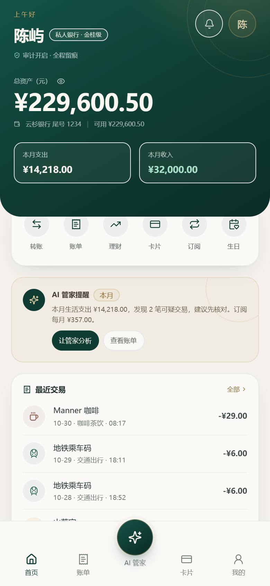 |  |

### 账单与卡片

| 账单 | 卡片 |
| --- | --- |
| 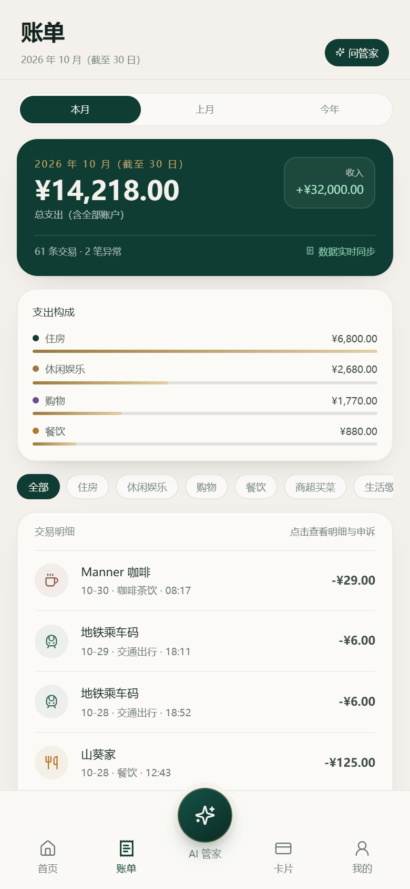 | 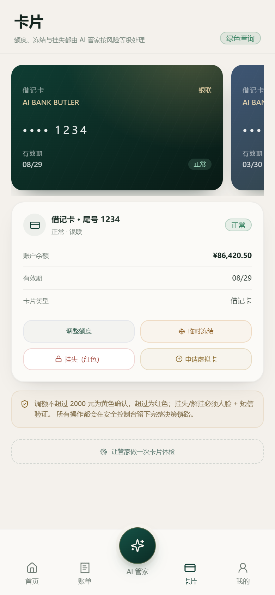 |

### 对话与我的

| 余额回执 | 我的 |
| --- | --- |
| 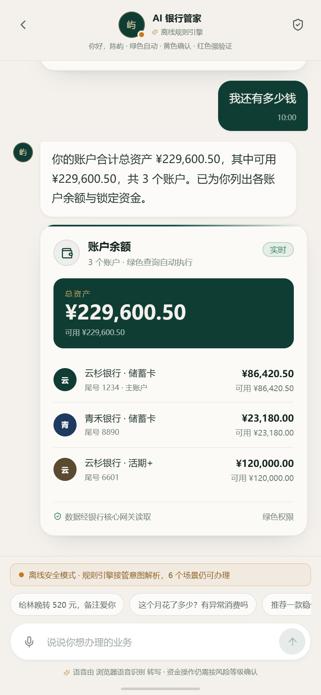 | 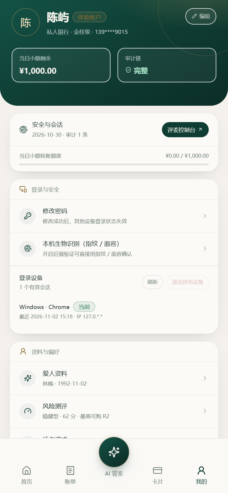 |

### 登录 / 注册 / 控制台

| 登录 | 注册（360px） | 控制台 |
| --- | --- | --- |
| 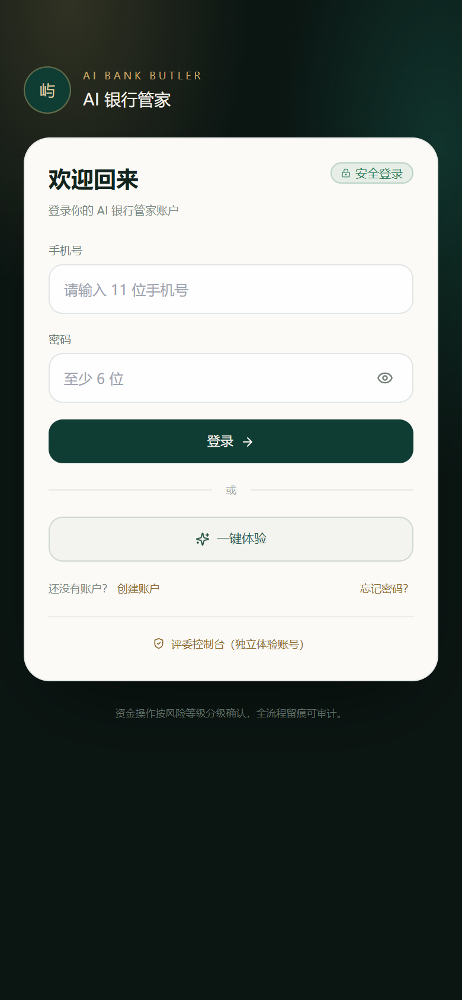 | 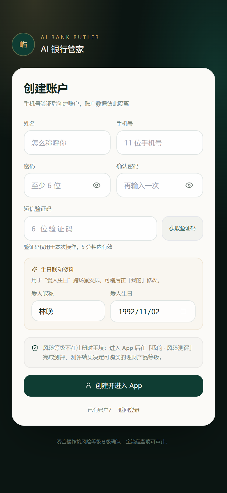 | 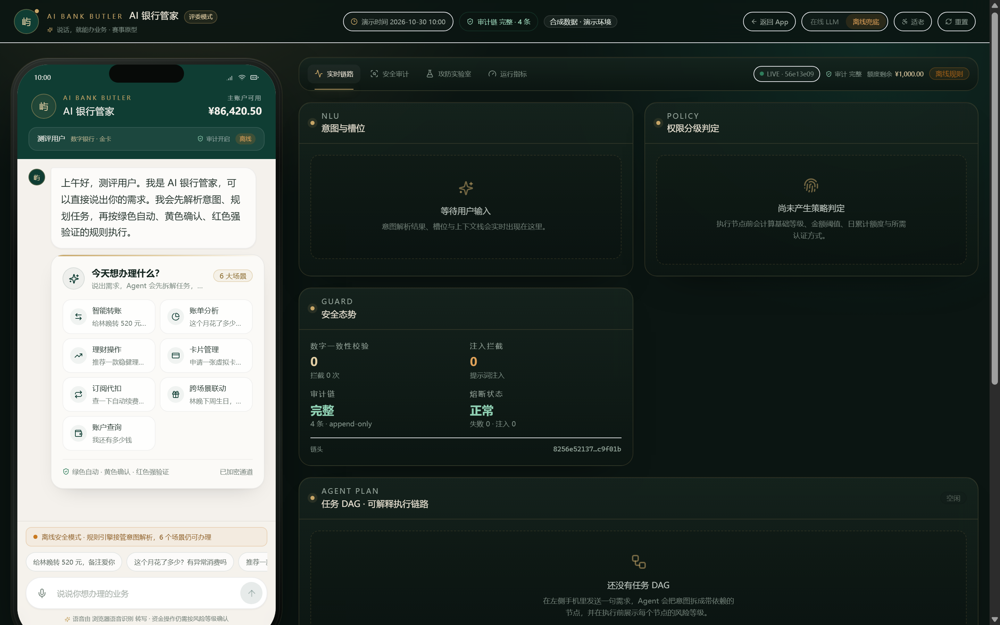 |

> 截图来自本轮生产构建 + 离线规则引擎，演示数据为合成数据。

## 8. 第二轮巡检（2026-11-01）

第一轮列出的产品化缺口已补齐，本轮针对新增能力做真实浏览器回归：`node tools/qa-product.mjs`（生产构建 + headless Chrome + CDP，390×844 / 1440×900 / 1024×768 / 375×812 四档视口），26 项检查全部通过，报告与截图落在 `docs/assets/product-review/qa-*.png` 与 `qa-product.json`。

### 8.1 本轮新增的产品能力

| 能力 | 落地位置 | 关键约束 |
| --- | --- | --- |
| 注册短信验证 | 注册页验证码字段 + `POST /api/auth/otp/send` | 缺码 `OTP_REQUIRED`、错码 `OTP_INVALID`、3 次锁定；手机号是否已注册不回传 |
| 登录二次验证 | 登录页 MFA 分支 + `POST /api/auth/login/mfa` | `LOGIN_MFA=1` 时密码通过仍不发 Cookie |
| 找回密码 | 独立 `/forgot-password` 三步页 | 一次性令牌 5 分钟，用过即 `RESET_INVALID`；成功后踢出其他设备 |
| 修改密码与设备管理 | 我的 → 登录与安全 | 服务端会话表，可撤销指定设备或退出其他设备，撤销后旧 Cookie 立即 401 |
| 风险测评 | 我的 → 风险测评（分题弹层 + 结果页） | 5 题 100 分；等级→可购上限 R1…R5；365 天有效期；结果写审计链 |
| 适当性硬校验 | 理财推荐与申购 | 超上限产品不进入推荐并说明排除数量；申购直接失败并给出重测指引 |
| 交易详情 | 账单页点击交易行 | 展示付款方式、账户、附言、关联订阅/产品、疑似重复扣费与异常原因 |
| 争议工单 | 详情页申诉表单 + 账单页工单区块 | 180 天时限、每用户每小时 5 次、重复提交 `DISPUTE_EXISTS`、状态时间线与预计完成时间 |
| 离线提示 | 产品壳顶部横幅 | 断网时明确“展示的是最后一次成功加载的数据，操作不会本地排队” |

### 8.2 本轮发现并修复

| # | 问题 | 处理 |
| --- | --- | --- |
| 1 | 测评结果页“可适当性购买 R1–R1”使用提交前缓存的上限 | 结果页改用提交接口返回的 `maxProductRisk` |
| 2 | 争议工单时间用真实墙钟，与演示业务时钟（2026-10-30）不一致 | 仿真核心改用业务时钟生成 `createdAt / expectedFinishAt` |
| 3 | 控制台在 375px 宽度出现 8px 横向溢出（手机预览固定 390px） | 窄屏改用 `zoom` 缩放手机预览，同时压缩布局宽度 |
| 4 | 注册与资料接口允许直接提交 `riskLevel`，绕过适当性管理 | 注册不再接收该字段（新账号记为未测评、上限 R1）；`/api/profile` 带 `riskLevel` 返回 `RISK_ASSESSMENT_REQUIRED`，数据层同步移除该写入路径 |
| 5 | 产品端最小字号 7px、辅助文字对比度约 2.9:1 | 全站字号下限抬到 8.5px（辅助文字 9–9.5px），灰字统一为 `#6f7c74`，深色背景灰字抬到 `#93a49a`，实测最小字号 8.5px |
| 6 | 装饰动画在“减少动效”系统设置下仍持续 | 增加 `prefers-reduced-motion` 兜底 |

### 8.3 回归结果

- TypeScript：服务端与前端 `--noEmit` 均通过。
- Vitest：8 个文件 / 105 个用例通过（新增 `risk.test.ts` 9 例、`dispute.test.ts` 9 例）。
- 离线冒烟 `npm run smoke`：26 段断言、224 条审计校验通过。
- 全量冒烟 `npm run smoke:full`：HTTP 银行核心 + HTTP 短信/人脸，231 条审计校验通过。
- 产品 UI 回归：注册（无风险等级手填 + 短信码自动填入）、未测评提示、测评流程与回显、编辑资料无风险项、交易详情、争议受理与工单回显、找回密码页、控制台三档视口无横向溢出、首页 375 无溢出。
- 已知未改：账单页“申诉工单”区块只在有工单时出现；理财仍通过 AI 对话办理，未做独立管理页。

### 8.4 本轮截图

| 测评答题 | 测评结果 | 我的（回显新等级） |
| --- | --- | --- |
| 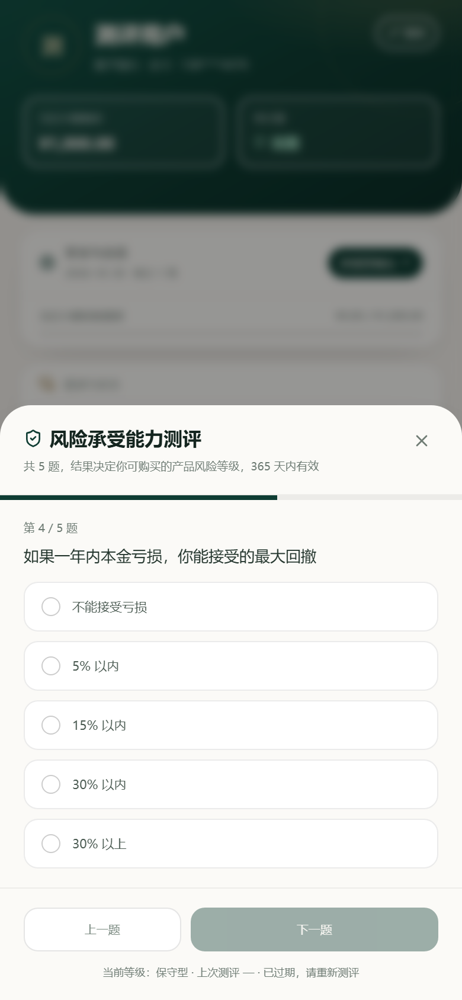 | 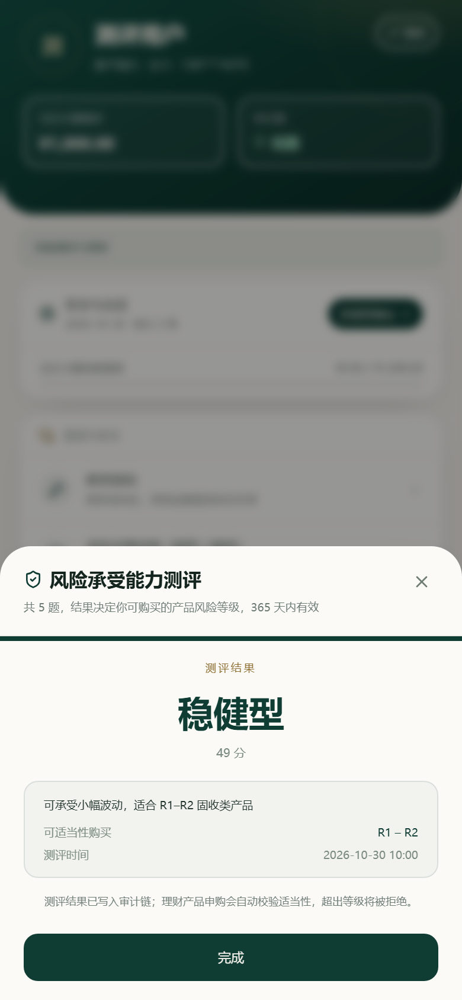 | 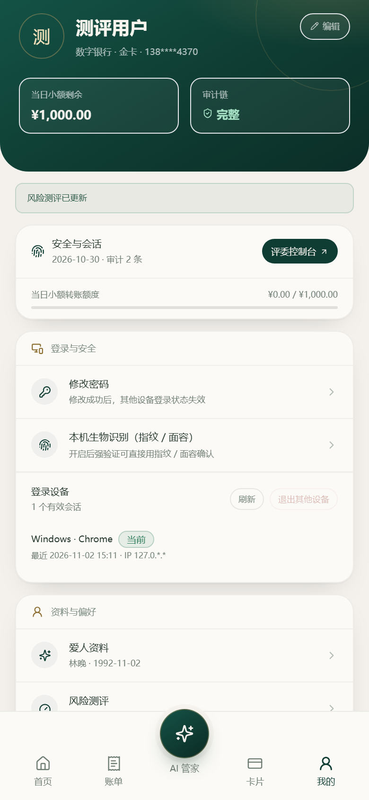 |

| 交易详情 | 争议工单 | 账单页工单区块 |
| --- | --- | --- |
| 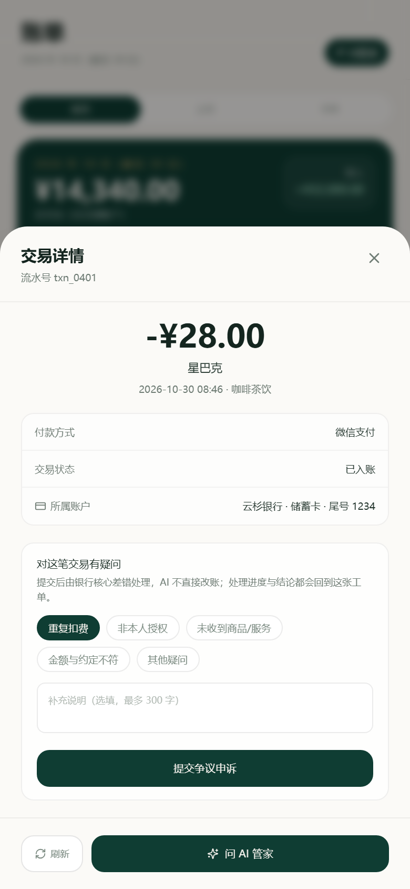 | 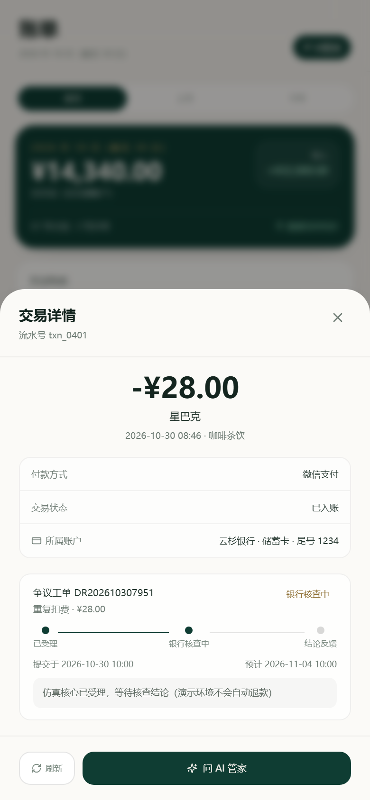 | 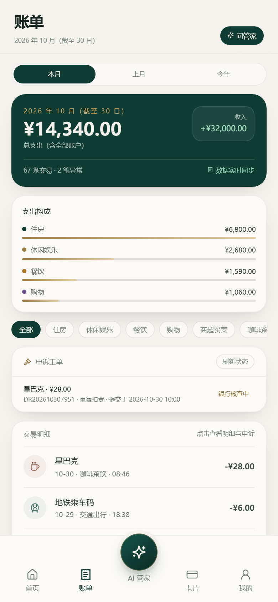 |

| 注册（390px） | 找回密码 | 首页（375px） |
| --- | --- | --- |
| 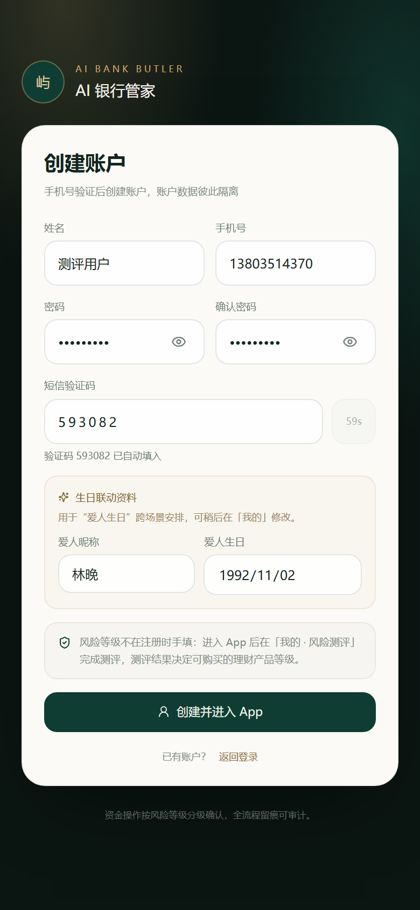 | 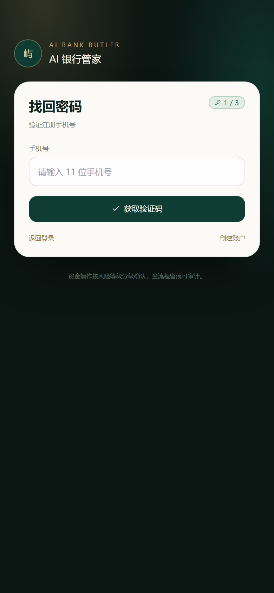 | 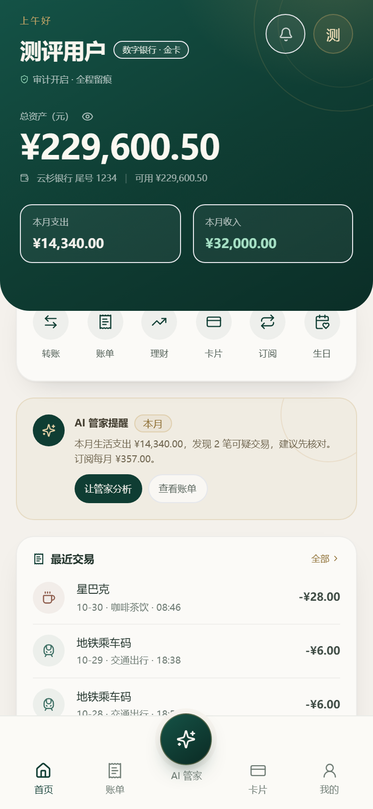 |

| 控制台 1440 | 控制台 1024 | 控制台 375 |
| --- | --- | --- |
|  | 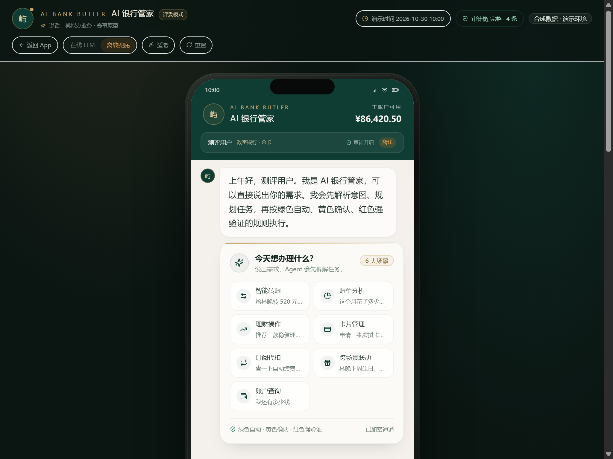 | 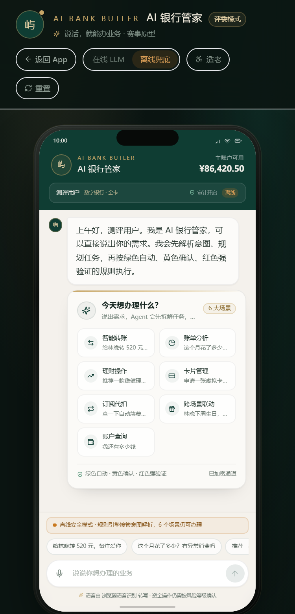 |
